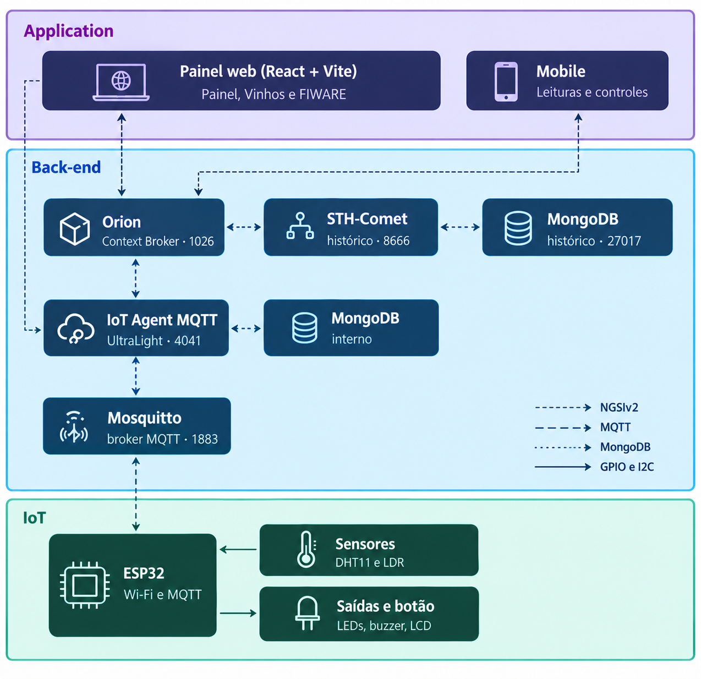

# Adega Monitor – Monitoramento de vinheria com ESP32 e FIWARE

Sistema de IoT que monitora **temperatura, umidade e luminosidade** de uma adega e avisa quando algum valor sai da faixa ideal do vinho armazenado. Um ESP32 lê os sensores e publica os dados via MQTT. A plataforma FIWARE guarda os valores e o histórico, e um painel web mostra tudo em tempo real e permite controlar o dispositivo remotamente.

## Como funciona

```
 Sensores ──► ESP32 ──MQTT──► IoT Agent (UltraLight) ──► Orion Context Broker ──► STH-Comet (histórico)
                ▲                     ▲                          │
                │                     └──── comandos ◄───────────┤
                └──────────── (on, off, alert_on, alert_off, wine)│
                                                                  ▼
                                                        Painel web (React + Vite)
```

- O **ESP32** publica leituras e alertas no broker MQTT e recebe comandos do painel.
- O **IoT Agent** traduz as mensagens MQTT para o Orion e repassa os comandos ao dispositivo.
- O **Orion** guarda o estado atual da entidade `urn:ngsi-ld:Lamp:200`.
- O **STH-Comet** guarda o histórico usado nos gráficos.
- O **painel web** consulta o Orion a cada 3 segundos, mostra as leituras e envia comandos.

## Arquitetura em camadas



O sistema segue o modelo de referência do FIWARE, dividido em três camadas:

| Camada | Componentes | Função |
|---|---|---|
| **Application** | Painel web (React + Vite) | Mostra as leituras, envia comandos e configura o servidor. Fala com o Orion (porta 1026) e com o IoT Agent (porta 4041), pelo proxy do Vite |
| **Back-end** | Orion, STH-Comet, IoT Agent MQTT, MongoDB e broker Mosquitto | Guarda o estado atual (Orion) e o histórico (STH-Comet com MongoDB), traduz o MQTT para NGSIv2 (IoT Agent) e transporta as mensagens (Mosquitto, porta 1883) |
| **IoT** | ESP32, sensores (DHT11 e LDR), LEDs, buzzer, LCD e botão | Lê o ambiente, publica as leituras via MQTT, recebe comandos e dispara os alertas locais |

As ligações entre as camadas usam NGSIv2 (painel e Orion), MQTT (IoT Agent, broker e ESP32) e MongoDB (STH-Comet e IoT Agent com seus bancos).

## Funcionalidades

- Leitura de temperatura e umidade (DHT11), luminosidade (LDR) e exibição em um LCD 16x2.
- Cadastro de vinhos no painel (Tinto, Branco, Rosé, Espumante ou Personalizado), cada um com suas faixas ideais. O vinho selecionado define os limites de alerta do ESP32.
- Sistema de alertas que pode ser **armado ou desarmado** pelo painel.
- Alerta com **LED azul piscando** e **buzzer** com um som diferente para cada tipo de problema.
- **LEDs indicadores** por parâmetro fora da faixa (amarelo, vermelho e verde).
- Botão físico que navega entre as telas do LCD.
- Aba FIWARE no painel que verifica o servidor e faz a configuração inicial com um clique.

## Hardware

| Componente | Quantidade | Observação |
|---|---|---|
| ESP32 DevKit | 1 | A placa precisa ter LED no GPIO 2, ou use um LED externo |
| Sensor DHT11 | 1 | No Wokwi é simulado como DHT22 |
| Módulo LDR (sensor de luz) | 1 | Saída analógica |
| LCD 16x2 com módulo I2C | 1 | Endereço `0x27` (alguns módulos usam `0x3F`) |
| Buzzer **passivo** | 1 | O buzzer ativo não reproduz os tons diferentes |
| LEDs amarelo, vermelho e verde | 3 | Com resistor de 220 Ω cada |
| Botão (push button) | 1 | Entre o GPIO 4 e o GND |

### Ligações

| Função | Pino do ESP32 |
|---|---|
| LED azul (onboard) | GPIO 2 |
| LED amarelo (luminosidade) | GPIO 25 |
| LED vermelho (temperatura) | GPIO 26 |
| LED verde (umidade) | GPIO 27 |
| Buzzer | GPIO 18 |
| LDR (saída analógica) | GPIO 34 |
| DHT11 (dados) | GPIO 15 |
| Botão | GPIO 4 (usa pull-up interno) |
| LCD I2C (SDA / SCL) | GPIO 21 / GPIO 22 |

O arquivo `firmware/vinheria/diagram.json` reproduz esta montagem no simulador Wokwi.

## Estrutura do projeto

```
.
├── docs/
│   └── arquitetura.png   # diagrama da arquitetura em camadas
├── firmware/
│   └── vinheria/
│       ├── vinheria.ino  # firmware do ESP32
│       ├── diagram.json  # circuito do Wokwi
│       └── libraries.txt # bibliotecas do Wokwi
├── api/
│   └── proxy.js          # proxy do Vercel para o servidor FIWARE
├── vercel.json           # redireciona /orion, /iota e /sth para api/proxy.js
├── vite.config.js        # proxy para o servidor FIWARE (npm run dev)
├── package.json
├── README.md
└── src/
    ├── main.jsx
    ├── App.jsx           # painel, controles, conexão e comunicação com o FIWARE
    ├── Metric.jsx        # cartão de leitura com faixa ideal e gráfico
    ├── WinePanel.jsx     # cadastro e avaliação dos vinhos
    ├── FiwarePanel.jsx   # verificação e configuração do servidor
    ├── fiware.js         # requisições ao IoT Agent, Orion e STH-Comet
    └── *.css
```

## Requisitos

- **Servidor FIWARE** (por exemplo, uma instância AWS EC2) com Orion, IoT Agent UltraLight (MQTT), STH-Comet, MongoDB e um broker MQTT.
- **Portas liberadas** no Security Group: `1026` (Orion), `4041` (IoT Agent), `8666` (STH-Comet) e `1883` (MQTT).
- **Node.js** (versão atual) e npm para o painel.
- **Arduino IDE** (ou PlatformIO) com suporte ao ESP32 e as bibliotecas `PubSubClient`, `DHT sensor library` e `LiquidCrystal I2C`.

## Instalação e execução

### 1. Painel web

```bash
npm install
npm run dev
```

Antes de iniciar, abra `vite.config.js` e confira o IP do servidor:

```js
const HOST = '44.199.198.20' // IP público da sua instância
```

O proxy do Vite lê esse valor **apenas ao iniciar**. Se o IP mudar, edite o arquivo e reinicie o `npm run dev`.

No painel, abra **Conexão** e confira:
- **ID da entidade:** `urn:ngsi-ld:Lamp:200`
- **fiware-service:** `smart`
- **IP do servidor:** o mesmo do `vite.config.js`

### 2. Configuração inicial do FIWARE

Abra a aba **FIWARE** e clique em **Configurar o que falta**. Isso cria, nesta ordem:

1. Grupo de serviço (apikey `TEF`)
2. Dispositivo `lamp200` com seus atributos e comandos
3. Registro de comandos no Orion
4. Assinatura do STH-Comet (histórico)

Se o IP do servidor mudar, as etapas que guardam o IP aparecem como **Pendente**, e o mesmo botão as refaz. O botão **Recriar dispositivo e comandos** refaz o dispositivo e o registro do zero, sem apagar os dados já guardados.

### 3. ESP32

Abra `firmware/vinheria/vinheria.ino` e ajuste o bloco de configuração:

```cpp
#define SIMULACAO_WOKWI 0                  // 0 = ESP32 físico (DHT11), 1 = Wokwi (DHT22)

const char* default_SSID = "NOME_DO_WIFI"; // rede 2,4 GHz
const char* default_PASSWORD = "SENHA";
const char* default_BROKER_MQTT = "44.199.198.20"; // IP do servidor
```

Grave no ESP32 e abra o Monitor Serial a 115200 baud para acompanhar.

### Simulação no Wokwi

Cole o conteúdo de `firmware/vinheria/diagram.json` e `firmware/vinheria/libraries.txt` no projeto, deixe `SIMULACAO_WOKWI` em `1` e use `Wokwi-GUEST` como rede, com senha vazia. O Wokwi só simula o DHT22. Por isso, o tipo do sensor muda conforme essa chave.

### Publicar no Vercel (acesso pelo celular)

O proxy do `vite.config.js` só existe no `npm run dev`. No Vercel, quem faz esse papel é a função `api/proxy.js`, ligada pelo `vercel.json`. Ela também resolve o bloqueio de conteúdo misto: o site no Vercel usa HTTPS e o servidor FIWARE responde em HTTP, então o navegador não pode chamá-lo direto.

1. No Vercel, abra o projeto e vá em **Settings → Environment Variables**.
2. Crie a variável `FIWARE_HOST` com o IP público do servidor (por exemplo, `44.199.198.20`), sem `http://` e sem porta. Marque Production, Preview e Development.
3. Faça um novo deploy (**Deployments → ⋯ → Redeploy**). Variáveis só valem para deploys feitos depois de criadas.
4. Abra o endereço do projeto no celular. No painel, em **Conexão**, confira o ID da entidade, o `fiware-service` e o IP do servidor.

Quando o IP da instância mudar, atualize `FIWARE_HOST`, faça um novo deploy e rode **Configurar o que falta** na aba FIWARE. Com um Elastic IP na AWS, o IP deixa de mudar e esse passo some.

Se o painel mostrar `502` ou `504`, a função não alcançou o servidor: confira se a instância está ligada, se o IP em `FIWARE_HOST` está certo e se as portas `1026`, `4041` e `8666` estão liberadas no Security Group. Um `500` indica que `FIWARE_HOST` não foi configurada.

O painel só consulta o servidor com a aba visível, o que poupa bateria no celular e chamadas da função.

## Usando o painel

| Aba | Função |
|---|---|
| **Painel** | Leituras em tempo real, faixa ideal, gráficos, alertas ativos, controles e registro de atividade |
| **Vinhos** | Cadastro dos vinhos e avaliação das condições em relação ao vinho selecionado |
| **FIWARE** | Verificação do servidor, configuração inicial e requisições manuais |

**Controles do painel**
- **Sistema de alertas:** arma ou desarma o buzzer e o LED azul piscando.
- **LED azul:** liga ou desliga o LED da placa (durante um alerta, ele pisca e o estado pedido só volta ao fim do alerta).

**Vinhos**
- Ao selecionar ou editar um vinho, o painel envia ao ESP32 o nome e as faixas dele (temperatura, umidade e luz máxima). O ESP32 passa a usá-las nos LEDs, no buzzer e no LCD.
- Os vinhos ficam salvos no navegador (`localStorage`). Se você limpar os dados do navegador, eles são apagados.
- Os valores iniciais de cada tipo são referências comuns. Confira a recomendação do produtor no rótulo.

## Alertas e LCD

**Faixas padrão do ESP32** (valem até um vinho ser selecionado no painel): temperatura de 10 a 18 °C, umidade de 60 a 80 % e luminosidade até 30 %.

**Sons do buzzer**

| Problema | Som |
|---|---|
| Temperatura | 1 tom longo |
| Umidade | 2 bipes curtos |
| Luminosidade | 3 bipes rápidos |

Se houver mais de um problema ao mesmo tempo, os sons se alternam. Alerta, buzzer e LED azul piscando só funcionam com o sistema **armado** e terminam quando todos os valores voltam à faixa.

**Telas do LCD** (o botão avança uma tela por aperto, e depois de 8 segundos o LCD volta às leituras)

1. Leituras: temperatura, umidade, luminosidade e estado do alerta
2. Vinho monitorado
3. Faixas ideais do vinho
4. Alertas: armado ou desarmado e o que está fora da faixa
5. Rede: situação do WiFi e do MQTT, e o IP

## Comunicação MQTT

**Comandos** (tópico `/TEF/lamp200/cmd`)

| Comando | Efeito |
|---|---|
| `lamp200@on\|` | Liga o LED azul |
| `lamp200@off\|` | Desliga o LED azul |
| `lamp200@alert_on\|` | Arma o sistema de alertas |
| `lamp200@alert_off\|` | Desarma o sistema de alertas |
| `lamp200@wine\|NOME,tmin,tmax,hmin,hmax,lmax` | Define o vinho e as faixas |

O Orion rejeita os caracteres `; < > " ' = ( )` em valores. Por isso o comando `wine` usa a vírgula como separador, e o painel remove esses caracteres do nome do vinho.

**Atributos publicados** (base `/TEF/lamp200/attrs`)

| Tópico | Atributo no Orion | Conteúdo |
|---|---|---|
| `/attrs` | `state` | `s\|on` ou `s\|off` |
| `/attrs/t` | `temperature` | Temperatura (°C) |
| `/attrs/h` | `humidity` | Umidade (%) |
| `/attrs/l` | `luminosity` | Luminosidade (%) |
| `/attrs/a` | `alert` | Alerta geral (0/1) |
| `/attrs/at` | `alertTemperature` | Anomalia de temperatura (0/1) |
| `/attrs/ah` | `alertHumidity` | Anomalia de umidade (0/1) |
| `/attrs/al` | `alertLuminosity` | Anomalia de luminosidade (0/1) |
| `/attrs/ar` | `armed` | Sistema armado (0/1) |

## Problemas comuns

| Sintoma | Causa provável e solução |
|---|---|
| Painel mostra `Orion respondeu 403` | Rede local bloqueando as portas (comum em redes de faculdade) ou proxy do Vite com IP antigo. Use um hotspot de celular e reinicie o `npm run dev` |
| `Não foi possível alcançar o servidor` | IP errado, instância desligada ou portas fechadas no Security Group |
| `Entidade não encontrada no Orion` | O ESP32 ainda não publicou. Ligue o ESP32 e confira se está conectado ao MQTT |
| Controles dão erro 404 | O registro de comandos precisa usar `legacyForwarding: false`. Na aba FIWARE, use **Configurar o que falta** ou **Recriar dispositivo e comandos** |
| Tudo parou depois de reiniciar a instância | O IP público muda a cada parada e início. Atualize o IP no `vite.config.js` (e reinicie), no campo Conexão e no sketch, e depois rode **Configurar o que falta** |
| `Falha na leitura do sensor DHT!` | `SIMULACAO_WOKWI` não corresponde ao sensor usado, ou fiação do DHT no GPIO 15 |
| LCD em branco | Endereço I2C errado (`0x27` ou `0x3F`) ou contraste no potenciômetro do módulo |
| LCD preso em "Conectando WiFi" | SSID ou senha incorretos, ou rede de 5 GHz |
| LCD preso em "Conectando MQTT" | Porta 1883 fechada ou IP do broker errado |
| Luminosidade ao contrário | Use `luminosity = 100 - luminosity;` na função `handleSensores()` |
| Buzzer toca um som único | O buzzer é ativo. Use um passivo |

## Limitações conhecidas

- Sem Elastic IP, o IP da instância muda a cada parada e início, e é preciso atualizá-lo (ver acima).
- Ao reiniciar, o ESP32 volta às faixas padrão e ao sistema desarmado. Reselecione o vinho e arme o sistema pelo painel.
- Enquanto o WiFi ou o MQTT estiverem fora, o `loop()` fica preso na reconexão, e o LED e o buzzer ficam parados.
- O sistema não tem autenticação: as portas do servidor ficam abertas. Para algo além de um projeto acadêmico, restrinja o acesso por IP e use um proxy de autenticação.

## Créditos

O firmware parte de um sketch de Fábio Henrique Cabrini. O painel e os demais ajustes foram desenvolvidos pela equipe para este projeto.

| Integrante | RM |
|---|---|
| Guilherme Kooji Kubota | 570541 |
| Victor da Silva Souto | 571093 |
| Luis Carlos Pageu Domingues | 569214 |
| João Paulo Francisco de Oliveira | 571306 |
| Eduardo Menzel | 570405 |